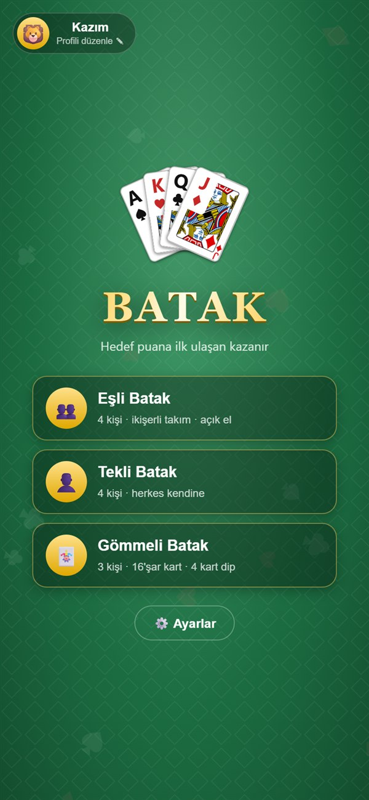
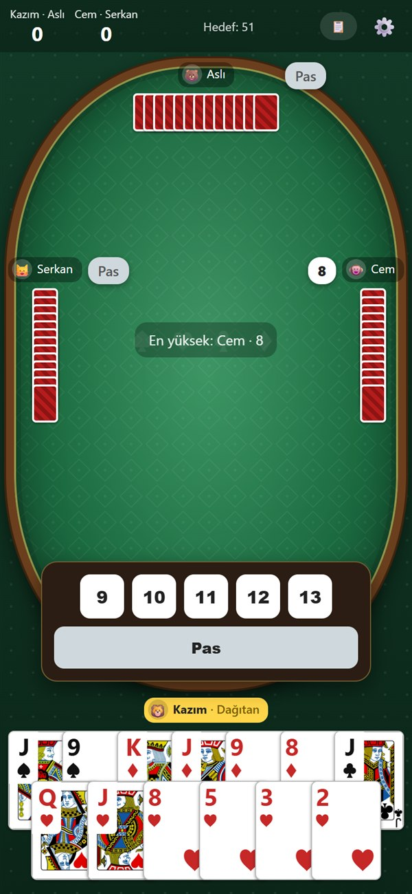
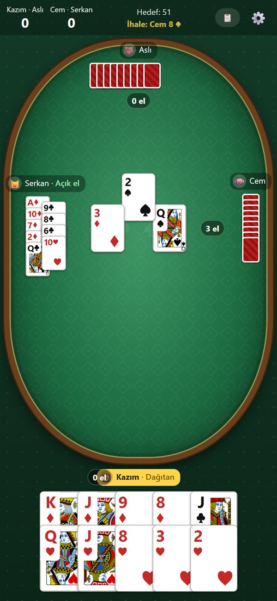
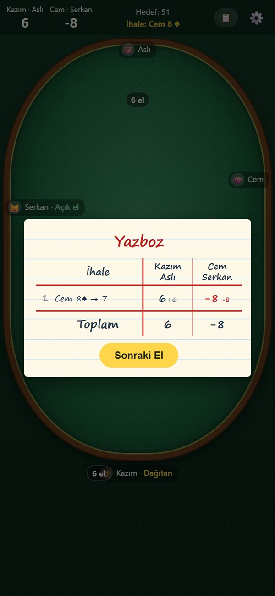
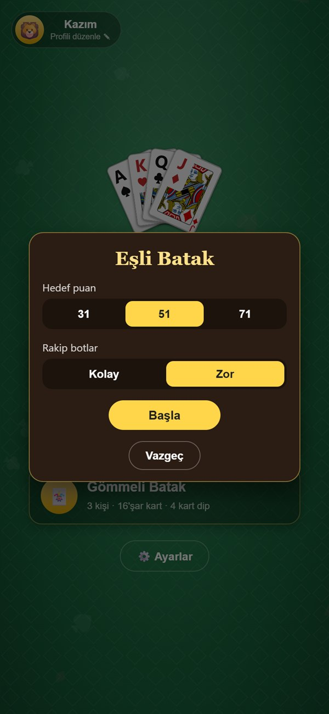

# Batak

Tarayıcıda, botlara karşı oynanan Türk kart oyunu **Batak**. Kurulum gerekmez; telefonda ana ekrana eklenip uygulama gibi, internetsiz de oynanabilir.

### ▶️ [Hemen oyna: oyununadibatakdayi.netlify.app](https://oyununadibatakdayi.netlify.app)

<p align="center">
  
  
  
  
</p>

## Özellikler

- **Üç oyun türü**
  - **Eşli Batak:** 4 kişi, ikişerli takım. İhaleyi alanın eşinin eli açılır.
  - **Tekli Batak:** 4 kişi, herkes kendine.
  - **Gömmeli Batak:** 3 kişi, 16'şar kart, 4 kart dip.
- **Akıllı botlar:** Kolay ve zor iki seviye. Zor botlar oynanan kartları takip eder, rakiplerin hangi renkte bittiğini çıkarır ve ihaleyi takım olarak değerlendirir. Gizli ellere asla bakmazlar; sadece masada görünen bilgiyle oynarlar.
- **İhale ve koz:** Gerçek kurallara göre ihale, herkes pas derse zorunlu giriş, koz seçimi.
- **Yazboz:** Her elin ihalesi ve puanları kâğıt görünümlü bir tabloda tutulur. Hedef puan 31, 51 ya da 71 seçilebilir.
- **Kaldığın yerden devam:** Oyun her el sonunda kaydedilir; sayfayı kapatsan bile "Devam Et" ile dönebilirsin.
- **Profil:** Kendi adın ve avatarınla oturursun.
- **Telefona kurulabilir (PWA):** "Ana ekrana ekle" ile uygulama gibi açılır, internetsiz de çalışır.

<p align="center">
  
</p>

## Teknik

- Tek bir `index.html` dosyası: saf HTML, CSS ve JavaScript. Hiçbir kütüphane ya da framework kullanılmadı.
- İnternetsiz oynama için Service Worker (`sw.js`) ve web uygulaması manifesti.
- Botların taktiklerini sınayan otomatik testler (`testler/taktik-testleri.js`). Botlarda rastgelelik olduğu için her senaryo 40 kez çalıştırılır ve her seferinde doğru sonuç vermesi beklenir.

## Klasörler

| Klasör / dosya | İçerik |
| --- | --- |
| `oyun/` | Oyunun kendisi; Netlify'da yayınlanan klasör |
| `testler/` | Bot taktik testleri |
| `serve.ps1` | Oyunu bilgisayarda `http://localhost:8765` adresinde açan küçük sunucu |
| `docs/` | README'deki ekran görüntüleri |

## Bilgisayarda çalıştırma

En kolayı `oyun/index.html` dosyasına çift tıklamak. Testleri çalıştırmak için yerel sunucuyu başlat:

```powershell
powershell -ExecutionPolicy Bypass -File serve.ps1
```

Sonra `http://localhost:8765` adresini aç, tarayıcı konsoluna `testler/taktik-testleri.js` içeriğini yapıştır.

## Kaynaklar

Vale, kız ve papaz kart resimleri: Byron Knoll, [Vector Playing Cards](https://opengameart.org/content/playing-cards-vector-png) (kamu malı / CC0).
